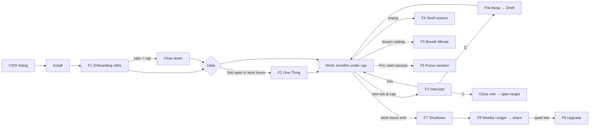

# DeepWork Tab — Design Doc v2: "Depth of Field"

*Drafted 2026-10-11. Status: **proposal**. It replaces `DESIGN.md` ("The Held Breath") once you approve it. The visual companion (every screen, the flows and live motion) is the canvas: https://claude.ai/artifact/Q7rCTWM9ZsE1aeQ2GZrqUP (private until shared).*

> **One line:** focus is a narrow depth of field. One thing is sharp and everything else is soft. The product does exactly that to the browser, and now the design does it too.

---

## Legend
| Symbol | Meaning |
|---|---|
| → | leads to |
| F1–F10 | user flows (§6) |
| S-xx | screen spec (§7) |
| ⚑ | decision needed from you |
| ✅ / 🟡 / ⛔ | shipped / partly shipped or new / not built |

---

## 0. TL;DR

1. **The master plan has the right soul and some wrong numbers.** Its behavioral spine (intercept, asymmetric delay, your own words, a safe queue) is already built and is the right product. It also contains invented metrics, pricing that contradicts the code, and a Stage 2/3 that breaks your own NEVER BUILD list. Corrections are in §1, and `MASTER_PLAN.md` has been edited to match.
2. **The new design system is "Depth of Field."** It is dark-first and has three signature ideas:
   - **Rack Focus.** Every entrance resolves from blur to sharp instead of sliding in.
   - **The Lens.** The cap gauge is a segmented ring that closes as tabs open.
   - **Lumen.** One warm-gold point of light is the only accent: the thing you're focused on.
3. **Two new rituals turn the tool into a habit.** **The One Thing** (morning) and **Shutdown** (end of work hours) bookend the day. Both reuse data you already store: work hours and your reason.
4. **The delay gate becomes a "Breath Minute."** It is the same 60 seconds, paced as six slow breaths around your own words. The friction stays and stops feeling like punishment.
5. **Queueing now *shows* where the tab went.** The page condenses and flies to the toolbar icon. That fixes the biggest learnability gap in the current UI, which needed the "your queue lives in the toolbar popup" copy plus a pin hint.
6. **About the awards, honestly.** Apple Design Awards only go to apps on Apple platforms, and Chrome on Android runs no extensions. The real badges for this product are the **Chrome Web Store "Featured" badge**, Product Hunt, and Awwwards for the site. The road to an ADA is a Safari Web Extension shipped as a Mac app, after the D14 gate (§3.4).
7. **No new runtime dependencies.** Springs use CSS `linear()`, the rest is vanilla. Three font files get bundled. Everything stays MV3-clean.

**⚑ Decisions for you (§16):** dark-first vs follow-system default · gold accent · rituals on by default or opt-in · rename now vs after D14.

---

## 1. Verdict on `docs/MASTER_PLAN.md`

**What it gets right.** The six-engine framing is a good story and it matches the code: intercept, asymmetric gate, your own words, safe queue, streaks. The positioning ("Your editor has a focus mode…"), zero-CAC distribution, the D14 kill gate, the intercept staying sacred (no upsell), the $29/$59 band and the launch sequencing are all right.

**What's wrong or stale.** Each item below has been fixed in the plan.

| # | Claim in plan | Reality | Fix |
|---|---|---|---|
| 1 | "Pay the $5" is the next action | You've paid it | Next action: assets, then submit |
| 2 | Bandwidth gauge "95% Available Bandwidth", "degrades working memory up to 50%" | No source supports these numbers. Leroy (2009) shows attention residue lowers task performance but gives no 50% figure. v0.3.0 also deliberately **removed** the toolbar badge | Replace with **The Lens** (count vs cap, no fake percentages) |
| 3 | "In 80% of instances naming the impulse dissolves it" | Invented | Nearest real evidence: one sec, PNAS 2023, **−57%** target-app opens (N=280) |
| 4 | Intercept "sub-10ms" | Unmeasured. Mechanism is `tabs.update` redirect after creation | Budget: **first paint ≤100 ms** after tab creation (RAIL), measured |
| 5 | "Research proves 66 days" | Lally et al. 2010: **median** 66 days, range 18–254 | "found a median of", and the streak never resets to shame |
| 6 | Free tier: cap 7 fixed, queue 20 items, JSON only; Pro: cap 1–20, Markdown | Code today: free cap 1–50, queue 200, **Markdown export is free** (TODO #5) | Don't take away shipped free features. That fights D14 (`PRICING.md`: "pricing must never fight the D14 metric") |
| 7 | Enterprise $12/user/mo column | NEVER BUILD: Teams | Moved to "post-gate options", no table column |
| 8 | Morning Frog, Shutdown, Bunker mode listed as features | Not built (Bunker ≈ Pro ultra-focus session) | Marked ⛔/🟡. Rituals designed here (F2, F7) |
| 9 | Stage 1 "$150K–$300K/yr" | Needs 3–5k lifetime sales ≈ 250k–420k installs at 1.2%. The exact category leader has ~4k users. Lifetime is one-time cash, not "/yr" | Labeled as a **ceiling scenario**. Base Y1 stays $3.7K (`FINANCE.md` SOM $1.7K–$11K) |
| 10 | Stage 2: mobile, Safari/Arc, sync | Breaks NEVER BUILD | Gated: only after D14 ≥10% **and** ≥100 paying users ask |
| 11 | HN + Product Hunt the same morning (Nov 2) | Splits your attention on the one day you can reply to everyone | HN Mon Nov 2, PH Tue Nov 3 |
| 12 | $5/mo Cloudflare | Ping + site fit the free Workers tier | $0 fixed until ~100k req/day |
| 13 | Missing | CWS Featured badge, review-ask moment, uninstall survey, activation definition | Added (§13, §14) |

---

## 2. Product truth (what the design must serve)

**Job:** *cap how many things may be open, and make it safe and calm to say no to the next one.* It is not "organize the pile" (OneTab) and not "block named sites" (Freedom). Source: `RESEARCH.md` §3.

### 2.1 People

| Persona | Moment of pain | What wins them | What loses them |
|---|---|---|---|
| **The Builder** (dev, 25–40) | Build running, opens HN "for a second", 40 tabs later | Keyboard-first, zero telemetry, taste | Anything that feels like a nanny, slow intercept |
| **The ADHD Knowledge Worker** | Tabs are working memory; closing feels like loss | Safety: nothing is ever lost, calm copy, the queue | Shame, red, streak-punishment, surprise closes |
| **The Ambitious Generalist** (writer, founder, student; this is *you*) | Busy all day, nothing finished, wants time back for money, health, craft | Rituals that frame the day, a weekly ledger worth sharing | Dashboards, guilt, setup over 60s |

### 2.2 Design principles (ranked; earlier one wins a conflict)

1. **Calm at the moment of weakness.** The intercept fires at the worst moment, so it de-escalates and never alarms.
2. **One thing in focus.** Every screen has exactly one sharp primary element. The rest is visibly secondary (literally softer).
3. **Your words outrank ours.** The user's typed reason and One Thing get the most distinctive type on any screen.
4. **Closing feels safe, and you can see why.** Show where things go. Every destructive-feeling action shows its recovery path.
5. **Friction is legible and asymmetric.** Tightening is instant and loosening takes a minute. The UI explains this and never punishes.
6. **Furniture, not a feed.** No reason to open the product for its own sake. No badges, points or re-engagement notifications.

### 2.3 Behavioral canon → design (audit added 2026-10-11)

The master plan's claim: the product solves three root causes of tab hoarding. Here is the honest coverage. ✅ = designed in this doc, ➕ = gap, closed by an addition below.

**Root cause → mechanism**

| Root cause | Before this audit | Additions |
|---|---|---|
| **Fear of context loss** | ✅ Shelf, File Away, undo, free Markdown export, "nothing is lost" copy | ➕ **Shelf note:** the intent sentence typed on the intercept is saved *with* the shelved page and shown on its row. The thought is kept, not just the URL |
| **Internal emotional discomfort** | 🟡 Calm intercept, Breath Minute, "What am I actually looking for?" | ➕ **Name the feeling:** an optional tap on the intercept (`bored · stuck · anxious · tired · curious`), stored locally. ➕ **Surf the urge:** "Ask me in 10 min" re-offers the page after 10 minutes. ➕ The Ledger shows "You reached most when *stuck*" |
| **Illusion all tasks matter equally** | 🟡 One Thing ritual and its line on the intercept | ➕ **Shelf has an order:** pages that serve today's One Thing pin to the top. Items older than 7 days soften (bokeh decay). ➕ **Weekly triage** at Friday Shutdown: keep / let go, one key each |

**Author → principle → where it lives**

| Author | Principle used | Design element | Status |
|---|---|---|---|
| **Cal Newport**: *Deep Work*, *Slow Productivity* | Attention residue (Leroy 2009). Shutdown ritual. Do fewer things | The cap itself. Lens. Focus session. **F7 Shutdown** ("Shutdown complete.") | ✅ |
| **Gary Keller**: *The ONE Thing* | The focusing question. Time-blocking the ONE Thing. 66-day habit horizon | **F2 One Thing** prompt: "the one that makes everything else easier, or unnecessary". Shown on every intercept. Focus session = time block | ✅ · ➕ **66-day path** (below) |
| **James Clear**: *Atomic Habits* | Identity-based habits. Four laws (obvious, attractive, easy, satisfying). Never miss twice | ➕ S-02 asks for an **identity**, not just a reason: "I'm someone who…". Obvious = Lens, easy = one key, satisfying = Settle + Ledger. ➕ **Never-miss-twice streak**: one loosened day doesn't break the run, two in a row do | ✅ · ➕ |
| **BJ Fogg**: *Tiny Habits* | B = MAP (motivation, ability, prompt). Anchor + tiny behavior + celebration. Start tiny | Prompt = intercept at the exact moment. Ability = Q in one key, onboarding ≤60s. Anchor = "after I open Chrome, I name my one thing". Celebration = Settle moment, fired *immediately* after the behavior. ➕ **Ease-in cap** (below) | ✅ · ➕ |
| **Nir Eyal**: *Indistractable* | Master internal triggers. Surf the urge / 10-minute rule. Pacts: effort, price, identity | Effort pact = 60s Breath Minute. Identity pact = your words on the gate. Price pact = deliberately **not built** (no paying to unlock). ➕ Feeling tap + 10-minute re-offer (above). Ramp (Pro) = escalating effort | ✅ · ➕ |
| **Brian Tracy**: *Eat That Frog!* | Do the most important task first. ABCDE priority. Single-handling | The One Thing is the frog, asked first thing. Focus session cap 3 = single-handling. ➕ **Frog first:** until the One Thing is marked done (or noon), the popup shows the shelf collapsed under "After your one thing". ➕ Shelf order + weekly triage = a light ABCDE | ✅ · ➕ |

**Additions in detail** (all local-only, no new permissions)

1. **Shelf note.** `queue` items gain an optional `note` (the intercept intent text, ≤140 chars). It shows as a second serif line on the row. Closes the context-loss gap. *Small: `lib/queue.js` + popup row.*
2. **Name the feeling.** Five chips under the intent field. Optional, never required. Each tap logs `{type:'feeling', value, ts}` to the existing week log. The Ledger adds one line: "Most reaches: *stuck* (9)". This is the core of Eyal's model: knowing the trigger beats blocking the site.
3. **Ask me in 10 min.** A fourth intercept action (`L` = later). The page is shelved with `remindAt = now+10m`. An alarm re-offers it as a quiet line in the next intercept or popup open: "Still want *youtube.com/…*? It's been 10 minutes." Reuses `snooze.js` (Pro snooze already exists). ✅ Free (decided 2026-10-12).
4. **Identity framing.** S-02 headline becomes "Who are you becoming?" with the field prefilled "I'm someone who…". Examples: "…finishes what I start", "…protects my mornings". The gate quotes it. *Copy-only change.*
5. **Never-miss-twice streak.** A streak survives one loosened day and breaks on the second consecutive one. The popup shows "day 12" and, on a miss, "Missed yesterday. Today keeps it alive." *Change in `ensureStreak` + test.*
6. **66-day path.** The streak line reads in three phases per Lally's median: Days 1–21 "Building", 22–45 "Settling", 46–66 "Becoming automatic". Day 66: one Settle moment and the Lens mark turns fully gold in the popup. No badge wall, no points.
7. **Ease-in cap (Fogg: start tiny).** Onboarding option shown when open tabs ≫ chosen cap: "Ease in: start at 15, drop one a day to 7." Lowering is tightening, so it's instant and needs no gate. *`lib/ramp.js`-style pure function + daily alarm.*
8. **Frog first.** The popup shelf collapses under "After your one thing" until the One Thing is done or it's noon. One click expands it. Gentle, not a lock.

**Still deliberately out:** Eyal's price pacts (paying to unlock), Clear-style public accountability partners (needs accounts or sync), and Tracy's full ABCDE lettering (too much UI for a 360px popup).

---

## 3. Platform reality and standards

### 3.1 Where this runs
- **Desktop Chrome** (macOS, Windows, ChromeOS, Linux) plus Chromium browsers that accept CWS extensions (Edge, Brave, Arc). That's free reach, but you only *support* Chrome.
- **Not mobile.** Chrome for Android/iOS doesn't run extensions. "Mobile-first" here means **narrow-first**: the popup is 360px and full-page surfaces must work down to 360px (small or split windows).

### 3.2 Chrome extension constraints that shape the design
| Constraint | Design consequence |
|---|---|
| MV3 CSP forbids remote code, and remote fonts are fragile | **Bundle** fonts as woff2 (Geist, Geist Mono, Instrument Serif Italic: OFL, ≈160 KB total, Latin subset) |
| Popup max 800×600, closes on blur | Popup = 360×≤600, single scroll, no modals inside the popup |
| Popup can't be opened programmatically on every Chrome version | Don't depend on it. The File Away animation points at the icon's *likely* location, top-right (§9.4) |
| No new permissions without review friction | Rituals use `alarms` + extension pages (already granted). **No** `notifications`, **no** `newtab` override |
| Service worker is stateless | All animation state lives in the page. The worker only decides |
| System toolbar icon is 16px, grayscale-hostile | The Lens mark must read at 16px in both toolbar themes (§13.1) |

### 3.3 Standards applied (what we take from each)
- **Apple HIG plus "Designing Fluid Interfaces."** Feedback on pointer-down. Interruptible motion that starts from the current value. Critically damped springs by default, bounce only after momentum. Spatial consistency (things leave the way they came). Materials convey hierarchy. Reduced motion, transparency and contrast are all honored. Size-specific tracking.
- **Material 3 (Expressive).** State layers (hover 8%, pressed 12%, focus ring) used as the *interaction-state* model, because Windows/ChromeOS users expect visible hover. Motion tokens organized by *spatial* vs *effects* springs, which maps onto our Rack Focus (effects) and File Away (spatial).
- **WCAG 2.2 AA.** 4.5:1 text and 3:1 UI. 2.4.11 focus not obscured. 2.5.7 dragging alternatives (the Lens cap picker has buttons and arrow keys). 2.5.8 targets ≥24px (we use 32px minimum, 44px primary). 2.3.3 animation from interactions can be turned off.
- **Windows `forced-colors`.** All states survive High Contrast mode (system colors, outlines not shadows).
- **Chrome Web Store best practices** (the Featured badge bar): MV3, minimal permissions with a justification for each, no remote code, clear privacy policy, polished first run, accessible UI.

### 3.4 Awards: the honest path
| Award | Eligible? | Path |
|---|---|---|
| **CWS Featured badge** | **Yes, now** | Meet best practices (above), then request review through CWS developer support. ⚑ Verify the current request process on the dev dashboard |
| CWS Established Publisher | Yes | Verified publisher identity + track record |
| Product Hunt Product of the Day / Golden Kitty | Yes | Launch plan F-day (§13.4) |
| Awwwards / CSS Design Awards | Yes, for the **site** | Site gets the same Depth of Field system + one live intercept demo |
| **Apple Design Award** | **Not as a Chrome extension** | A Safari Web Extension ships *inside a Mac/iOS app* on the App Store, which is ADA-eligible. Stage 2, gated on D14 ≥10% |
| Google Play / Material awards | No (no Android extension runtime) | — |

---

## 4. The concept: Depth of Field

**The metaphor.** A camera at f/1.4: the subject is razor-sharp and the world dissolves into soft light. That *is* deep work, and it's what the product does to the browser. So the design system's single primitive is **focus vs blur**. Paper (old) said "calm". Depth of Field says **"calm, and pointed at something."**

How the metaphor becomes a system:

| Idea | Becomes |
|---|---|
| Only one thing is sharp | One primary per screen. Secondary content sits at 64% contrast. Ambient background is literally blurred |
| Pulling focus | **Rack Focus**: every entrance resolves blur→sharp (8px→0), never slides |
| Aperture | **The Lens**: the cap gauge is a ring of N segments that closes as tabs open. Full ring = at cap |
| A point of light | **Lumen** (warm gold): the only accent. It marks *your* focus (the One Thing, the primary action, the active segment) |
| Light changes through the day | **Day Field**: the ambient background shifts with time of day (dawn, day, dusk, night) on full-page surfaces. You feel the workday pass |
| Bokeh | Off-focus content (queued items, tabs you could close) renders as soft rounded "bokeh" chips |

**Why this is radical but safe:**
- It flips the old doctrine of flat, no shadows, paper. It brings back real depth (materials, light, blur), which is how Apple's 2025 design language reads.
- It keeps what *worked*: the calm, the user's own words in serif italic, keyboard chips, and nothing looping without purpose.
- It's ownable. "Rack focus" as a brand motion is uncommon in productivity apps, and a gold Lens is a recognizable mark.

---

## 5. Information architecture

```
Toolbar icon (The Lens mark, 16px)
 └─ Popup (S-10)  ← Alt+Shift+D
     ├─ Lens + count            (status)
     ├─ Today's One Thing       (your words)
     ├─ Focus session control   (Pro)
     ├─ Shelf (queue)           ← Alt+Shift+Q adds current tab
     └─ Ledger (this week)      (only upsell line in the product)

Full-page surfaces (extension pages, Day Field background)
 ├─ Welcome / onboarding (S-01…S-05)   first install
 ├─ The One Thing (S-06)               first browser use of the day, in work hours
 ├─ Intercept (S-07, S-08)             new tab at cap
 ├─ Breath Minute gate (S-11)          any loosening change
 ├─ Shutdown (S-12)                    end of work hours
 ├─ Settings (S-13)                    single column, 3 groups
 └─ Pro unlocked (S-14)                after license activation

Off-product
 ├─ Site + pricing  ├─ Share card (S-15)  └─ Uninstall page
```

Rules: no navigation chrome. Every full-page surface has exactly **one** exit that's always visible (`Esc`), plus one primary action.

---

## 6. User flows

### 6.0 Master flow


Each flow below lists: trigger → steps → success state → edge cases → metric.

### F1. First run (onboarding), target ≤60s, 4 steps 🟡
**Trigger:** `runtime.onInstalled` (reason `install`) opens `options.html#welcome`.

| Step | Screen | User does | System does | Exit |
|---|---|---|---|---|
| 1 | S-01 Welcome | Reads one line, presses Begin (`↵`) | Rack-focus headline: *"Your editor has a focus mode. Your browser doesn't."* | Begin |
| 2 | S-02 Your reason | Types one sentence (≥12 chars to continue). Two tappable examples prefill | Shows the text live in serif italic: *this is what you'll see when you try to loosen* | Continue / Skip (reason then = generic) |
| 3 | S-03 Your cap | Drags the Lens or presses −/+ (←/→). Default 7, live preview of current tabs as segments | Shows "You have **12** open." Segments over cap glow Ember | Set cap |
| 4 | S-04 Your day *(optional)* | Toggles work hours (default 09:00–18:00 Mon–Fri) and "Start my day with One Thing" + "Shutdown at end" | Explains in one line that both happen only in work hours | Finish |
| 5 | S-05 Pin it | Sees an animated hint toward the puzzle icon → pin | Detects pin via `action.getUserSettings().isOnToolbar` (Chrome 91+) and ticks itself | Done |
| 5b | S-05b Clear-down *(if tabs > cap)* | Sees a list of open tabs as bokeh chips, picks to **queue** (default) or close, until under cap | Lens closes segment by segment as count drops. When under: Settle moment | "You're under. Go." |

**Success:** reason typed, cap set, icon pinned, under cap. **Metric:** onboarding completion ≥80%, reason-typed ≥80% (`TODO.md` validation #1), time-to-first-intercept <1h for ≥70%.
**Edges:** user closes the tab mid-onboarding → resume at the same step on next popup open. Reason skipped → the gate shows *"You didn't write a reason. Want to add one now?"* instead of a quote.

### F2. The One Thing (morning ritual) ⛔ new
**Trigger:** first `tabs.onCreated` of the calendar day **inside work hours**, if enabled. The opened tab is preserved as the target and the ritual page opens *in place* (same redirect mechanism as the intercept, so no new permission).

1. S-06 shows: *"Good morning. What's the one thing today?"* One field, optional URL.
2. `↵` → the text sets in Instrument Serif and *racks into focus*. Lumen dot appears beside it. "Saved for today."
3. The page then continues to the originally requested URL (it doesn't steal the tab).
4. `Esc` / "Not today" → skip. Never asks twice the same day.

**Where it shows up later:** popup header, every intercept ("Does this help with: *finish the migration script*?"), Shutdown ("Did you finish it?").
**Success:** One Thing set on ≥40% of work days among enablers. **Edge:** user opens Chrome at 08:55 with work hours from 09:00 → prompt on the first tab after 09:00.

### F3. The intercept (core loop) ✅ restyle + 🟡 additions
**Trigger:** `tabs.onCreated` when counted tabs > effective cap (current logic: `countedTabs`, `effectiveCap`, ramp).

1. S-07 renders (≤100ms) with **Rack Focus**: background Day Field already blurred, headline 8px→0, then supporting rows stagger by 40ms.
2. Hierarchy, top to bottom:
   - **Lens** (small, full ring) + "7 of 7"
   - **Headline** (rotating, day-stable)
   - **One Thing** (if set, serif italic): *"Today is for: finish the migration script."*
   - **Target**: favicon + domain + path, as a glass chip
   - **Last time you wrote** (reason recall, if any)
   - **Intent field**: "What am I actually looking for?"
   - **Actions**: Queue `Q` (primary, Lumen) · Close one `C` · Go back `Esc`
3. **Q** → **File Away** (§9.4): target chip condenses into a pill and arcs to the top-right. A "Saved to your shelf" tick follows, then the tab returns to the previous tab or closes (current behavior).
4. **C** → S-08 tab picker: open tabs as a list of glass rows with `1–9` hotkeys. Picking one: that row blurs out, the Lens segment releases, then the target opens in this tab.
5. **Esc** → back, no log of guilt.

**Ramp (Pro, existing `ramp.js`):** repeated intercepts for the same domain within 24h delay the buttons 3–10s. Visual: buttons sit at 40% opacity with a thin Lumen progress line under the button row. It never shows a countdown number (no pressure theatre).
**First-ever intercept:** one extra line (existing): *"Queued pages aren't lost. Reopen them from the toolbar."*, plus a one-time File Away demo that's slower (720ms) so the destination is learned.
**Metric:** % of intercepts resolved by Q or Esc (not a loosening) ≥75%.

### F4. Shelf (queue) restore ✅ restyle
Popup → Shelf list (newest first). Each row: favicon, title (1 line), domain (mono), relative time. Hover/focus shows "Open ↵" and "Remove ⌫".
- **Under cap** → opens in a new tab and the row slides out toward the top (spatial consistency: it leaves the way it came in).
- **At cap** → existing swap flow, shown *inline* as a mini picker ("Close one to open this").
- **Already open** → focuses that tab.
- **Remove** → row collapses with a 5s **Undo** in the status line (existing undo).
- **Export** → "Copy as Markdown" (free, unchanged) → status line "Copied 14 links".

### F5. Loosening → Breath Minute gate ✅ restyle + 🟡 breathing
**Trigger:** raise cap, disable, add exemption, edit active schedule (`rulesLoosen`).
1. S-11: the page dims, a glass sheet rises (the only modal in the product).
2. Center: **your reason**, in large serif italic. Around it a **breathing ring**: 6 cycles × 10s (inhale 4s / exhale 6s), with a thin Lumen arc tracking the full 60s.
3. Caption alternates "Breathe in" / "Breathe out" in muted text. The timer number is small and in mono (`0:42`), never huge or red.
4. At 0: ring settles, "Change applied." Sheet sinks. `Cancel: keep my limit` is visible the whole time and is the default focus.
**Why breathing:** slow paced breathing around 6 breaths/min is the common "resonance" rate in HRV-biofeedback research. It converts dead waiting into self-regulation. ⚑ Claim it softly in copy ("a slow minute"), never medically.
**Reduced motion:** ring static, captions only.

### F6. Focus session (Pro) ✅ restyle
Popup → "Start focus" → segmented choice (25 · 50 · 90 min) + session cap (default 3).
- Starting is instant (tightening). **Lens contracts**: segments above the session cap fade to bokeh. If open tabs exceed the session cap → Clear-down list (same as onboarding).
- During: popup Lens shows a thin outer arc for time remaining. The intercept adds "Focus session · 34 min left".
- End: S-09 moment, the arc completes into a full Lumen ring, *"Session complete. 50 minutes on: <One Thing>."* Not confetti.

### F7. Shutdown (end of work hours) ⛔ new
**Trigger:** `alarms` at schedule end. A ritual page opens **only if** enabled and the browser is active. If Chrome is idle or closed, the ritual is shown on the next open within 2h, else skipped.
1. S-12: Day Field at dusk. *"Workday complete."* Shows open tabs as bokeh chips + One Thing with "Done / Carry to tomorrow".
2. Primary: **"Shelve all and shut down"** → all chips File-Away into a dated shelf group ("Oct 11 · 6 tabs").
3. Final: *"Shutdown complete."* Big, calm, serif. Below it, small: today's line ("3 intercepts held · 1 thing finished").
**Edge:** the user is mid-call → "Later" snoozes 30 min once.

### F8. Weekly Ledger + share ✅ restyle + 🟡 image card
Popup Ledger section (week Mon–Sun): Held (intercepts not loosened), Shelved, Focus minutes (Pro), Top pull (domain). Pro: daily bars + domains.
**Share:** "Share this week" → generates S-15 (1200×630 PNG via `OffscreenCanvas`, no network). The copy button and X intent link already exist. The card is **privacy-safe by construction**: no domains unless toggled on.

### F9. Upgrade ✅ restyle
Only entry: the quiet line under the Ledger → site `#pricing` → Lemon Squeezy → email with key → Settings → Pro → paste → S-14 "Pro unlocked" (Lens fills gold once, lists what's new, one button "Try a focus session").
**Rule:** never in the intercept, never in rituals, never a modal.

### F10. Leave (uninstall) ✅
`runtime.setUninstallURL` → site uninstall page: 1 question (4 radio reasons + free text), and "Your shelf, as Markdown" reminder (the export lives in the popup, so mention it *before* uninstall via the Settings "Export everything" button).

---

## 7. Screen specs

Grid: full-page surfaces use a 12-col grid, content column 560px (intercept, gate) or 640px (onboarding, rituals), centered, top-weighted (optical center at 42% height). Popup 360px wide, 16px gutters.

| ID | Screen | One sharp thing | Supporting | Keyboard |
|---|---|---|---|---|
| S-01 | Welcome | Headline | 1 line sub, Begin | `↵` |
| S-02 | Your reason | The live serif preview of their sentence | Field, 2 example chips | `↵` continue |
| S-03 | Your cap | The Lens with number | −/+ buttons, "You have N open" | `←/→`, `↵` |
| S-04 | Your day | Work hours row | 2 ritual toggles | `Tab`, `Space` |
| S-05 | Pin it | Animated pointer to puzzle icon | Auto-ticks when pinned | `↵` skip |
| S-05b | Clear-down | Count to go ("Queue 5 more") | Bokeh chip list | `1–9`, `Q` all |
| S-06 | One Thing | The field / their sentence | Date, "Not today" | `↵`, `Esc` |
| S-07 | Intercept | Headline + primary Queue | Lens, One Thing, target, recall, intent | `Q`, `C`, `Esc`, `1–9` |
| S-08 | Intercept · pick | Tab list | Hint | `1–9`, `Esc` |
| S-09 | Session complete | Full ring + sentence | Minutes | `↵` |
| S-10 | Popup | Lens + count | One Thing, Shelf, Ledger | `↑/↓`, `↵`, `⌫` |
| S-11 | Breath Minute | Your reason | Ring, captions, Cancel | `Esc` cancels |
| S-12 | Shutdown | "Workday complete." / "Shutdown complete." | Chips, One Thing check | `↵`, `Esc` |
| S-13 | Settings | — (form) | 3 groups: Limit · Day · What counts. Pro section last | Standard |
| S-14 | Pro unlocked | Gold Lens | 3 lines | `↵` |
| S-15 | Share card | "142 tabs held" | Week, mark | — |
| S-10b | Popup · frog first | Today's frog + Mark done | Never-miss-twice line, 10-min re-offer, collapsed shelf | `↵` |
| S-16 | Friday triage | One shelf item at a time (oldest first) | Progress, note | `K` keep, `X` let go |

### 7.1 Popup states (S-10)
| State | Lens | Copy |
|---|---|---|
| Calm (≤60% of cap) | Lumen segments | "4 of 7" |
| Near (cap−1) | last segment pulses **once** on open | "6 of 7 · one left" |
| At cap | full ring | "7 of 7 · new tabs pause" |
| Over (e.g. lowered cap) | full ring + Ember notch | "9 of 7 · close 2" |
| Session | inner ring + outer time arc | "Focus · 34 min" |
| Off hours | ring at 30% opacity | "Resting until 09:00" |
| Empty shelf | — | "Nothing shelved. Good sign." |

---

## 8. Design system tokens

All tokens live in `shared/tokens.css` as CSS custom properties. Light and dark are both first-class. **⚑ Default: follow the system** (recommended), dark is the hero in marketing.

### 8.1 Color

**Neutrals: "Graphite" (dark) / "Mist" (light)**
| Token | Dark | Light | Use |
|---|---|---|---|
| `--ground` | `#0E0F11` | `#EEF0F2` | page background (under Day Field) |
| `--surface` | `#16181B` | `#FFFFFF` | popup, cards |
| `--raised` | `#1F2226` | `#F7F8F9` | hover rows, inputs |
| `--line` | `#2C3036` | `#DCDFE3` | hairlines (1px) |
| `--ink` | `#ECEDEE` | `#111317` | primary text |
| `--ink-2` | `#9AA0A8` | `#5A6069` | secondary text (≥4.5:1 on ground and surface) |
| `--ink-3` | `#6B717A` | `#868C95` | disabled, decorative only (not for text that matters) |

**Accent: Lumen (the one voice)**
| Token | Dark | Light | Use |
|---|---|---|---|
| `--lumen` | `#F5C46B` | `#F2B84B` | primary fill, active segments, focus dot |
| `--on-lumen` | `#16120A` | `#16120A` | text on lumen (≥10:1) |
| `--lumen-ink` | `#F5C46B` | `#8C5A00` | lumen-colored *text/links* (5.1:1 on Mist) |
| `--lumen-glow` | `rgba(245,196,107,.18)` | `rgba(242,184,75,.22)` | focus halo, selected row |

**Semantic (outcomes only, never decoration)**
| Token | Dark | Light | Rule |
|---|---|---|---|
| `--settled` | `#7FD1A8` | `#1F7A4D` | success, "you're under" |
| `--ember` | `#FF7A59` | `#B93815` | over cap only (Earned Red rule kept, renamed) |

**Day Field** (full-page surfaces only; two radial blobs, 120px blur, static per load):
| Phase | Hours (local) | Blob A | Blob B | Dark-mode blend |
|---|---|---|---|---|
| Dawn | 05–10 | `#F7D7A8` | `#C9D8F2` | 18% over ground |
| Day | 10–16 | `#DCE6F2` | `#E9EEF2` | 12% |
| Dusk | 16–20 | `#F2B8A0` | `#B9B4E0` | 18% |
| Night | 20–05 | `#2B3A66` | `#4A2F4F` | 30% |

Rules: **One Voice** (Lumen is the only expressive color). **Earned Ember** (only for a factual over-cap state). Gradients exist **only** as Day Field light, never on buttons, text or cards. `prefers-contrast: more` → Day Field off, `--ink-2` = `--ink`.

### 8.2 Typography
| Role | Face | Size/Line | Tracking | Weight | Use |
|---|---|---|---|---|---|
| Ritual | Geist | 64/1.0 | −0.035em | 600 | "Shutdown complete." |
| Display | Geist | 44/1.05 | −0.03em | 600 | intercept h1 |
| Title | Geist | 28/1.15 | −0.02em | 600 | onboarding steps |
| Heading | Geist | 17/1.3 | −0.01em | 600 | popup sections |
| Body | Geist | 15/1.5 | 0 | 400 | everything |
| Caption | Geist | 13/1.45 | +0.005em | 450 | meta |
| Micro | Geist | 11/1.3 | +0.04em | 550 | labels (max 2 per surface) |
| **Voice** | Instrument Serif *Italic* | 24/1.35 (S) · 36/1.2 (L) | −0.01em | 400 | **user's words only** |
| Data | Geist Mono | 13/1.5 | 0 | 400, tnum | URLs, counts, kbd, timers |
| Numeral | Geist | 96/1.0 | −0.04em | 200, tnum | Lens center number on large surfaces |

Fallbacks: `Geist, -apple-system, "Segoe UI Variable", system-ui, sans-serif`. Body in `rem`, scales with Chrome font size. **Your-Words rule (kept):** the user's text is always Voice style. App copy never is.

### 8.3 Space, size, radius
- Space (4pt): `2 4 8 12 16 24 32 48 64 96` → `--s0…--s9`.
- Hit targets: primary 44px tall, secondary 36px, list rows 44px, icon buttons 32×32 (≥24px WCAG 2.5.8).
- Radius: `--r-xs 6` (kbd) · `--r-sm 10` (buttons, inputs) · `--r-md 14` (cards, rows) · `--r-lg 22` (sheets) · `--r-pill 999`. **Concentric rule:** inner radius = outer − padding.

### 8.4 Elevation and materials
The old No-Shadow rule is retired. Depth now carries meaning (what's in focus floats).
| Level | Name | Recipe (dark) | Use |
|---|---|---|---|
| e0 | Ground | `--ground` + Day Field | page |
| e1 | Card | `--surface`, 1px `--line`, inset top highlight `rgba(255,255,255,.04)` | rows, target chip |
| e2 | Glass | `rgba(22,24,27,.66)` + `backdrop-filter: blur(24px) saturate(150%)`, 1px `rgba(255,255,255,.08)`, shadow `0 24px 48px -16px rgba(0,0,0,.5)` | intercept panel, sheets |
| e3 | Scrim | ground at 70% + blur(8px) | behind the Breath Minute only |

Light glass: `rgba(255,255,255,.72)`, border `rgba(17,19,23,.06)`, shadow `0 24px 48px -20px rgba(17,19,23,.18)`. Never stack glass on glass. `prefers-reduced-transparency` → solid `--surface`.

### 8.5 Iconography
1.5px stroke, 20px grid, round caps (Lucide-compatible geometry, drawn inline as SVG, ~8 icons total: shelf, close, back, focus, settings, export, check, sun-horizon). No icon fonts, no emoji.

---

## 9. Motion system

### 9.1 Principles
1. **Motion encodes state, never decoration.** Every animation answers "what changed / where did it go?"
2. **Focus, not travel.** Default entrance = Rack Focus (blur+opacity). Spatial travel is reserved for *meaningful destinations* (File Away to the toolbar, rows leaving the shelf).
3. **Interruptible.** Animations start from the current value. Pressing a key mid-animation commits instantly.
4. **One-shot.** Nothing loops, except the Breath Minute (user-initiated, purposeful, 60s, then stops).
5. **Reduced motion is a first-class design**, not "off". It uses 150ms cross-fades and static states.

### 9.2 Tokens
```css
--t-press: 90ms;    /* pointer-down feedback */
--t-quick: 160ms;   /* hover, state layers */
--t-base: 260ms;    /* rows, toggles */
--t-focus: 520ms;   /* rack focus */
--t-travel: 480ms;  /* file away */
--t-ritual: 900ms;  /* ritual headline reveals */

--ease-out: cubic-bezier(.16, 1, .3, 1);        /* exits from rest, reveals */
--ease-in-out: cubic-bezier(.65, 0, .35, 1);    /* breath */
/* Apple-style critically damped spring (damping 1.0, response .35s) → settles in ~515ms */
--spring: linear(0, 0.079, 0.237, 0.404, 0.552, 0.672, 0.764, 0.833, 0.884, 0.919, 0.945, 0.962, 0.974, 0.983, 0.988, 0.992, 0.995, 0.997, 0.998, 0.999, 1);
/* Momentum spring (damping .8, response .4s) → 1.5% overshoot, ~540ms; only after a flick/drag */
--spring-soft: linear(0, 0.052, 0.171, 0.316, 0.464, 0.598, 0.712, 0.805, 0.875, 0.927, 0.964, 0.988, 1.003, 1.011, 1.014, 1.015, 1.014, 1.012, 1.01, 1.008, 1.006, 1.004, 1.003, 1.002, 1);
```
`linear()` ships in Chrome 113+, so springs need zero JS and zero dependencies. Values generated from the closed-form spring equation, damping/response per Apple's WWDC 2018 talk.

### 9.3 Signature motions

**A. Rack Focus (entrance, every full-page surface)**
| t (ms) | Element | From → To | Easing |
|---|---|---|---|
| 0 | Day Field | opacity 0→1 | linear 300 |
| 40 | Headline | blur 8px→0, opacity 0→1, scale 1.015→1 | `--ease-out` 520 |
| 120 | Lens / meta | blur 6→0, opacity 0→1 | `--ease-out` 420 |
| 160+40n | Rows (stagger 40ms, max 5) | blur 4→0, opacity 0→1, y 6→0 | `--spring` 515 |
| 360 | Buttons | opacity 0→1 | 200 |

Interactive at **0ms**: keys work before the animation finishes. Budget: `filter: blur` only on text blocks ≤ 600×200px, and the background blur is a pre-blurred static layer (opacity only).

**B. Lens Fill (count change)**
Segment `stroke` color + `opacity` crossfade `--t-base`, stagger 20ms per segment in the direction of change. Reaching cap: the ring's gaps close (gap 4°→0°) with `--spring`, **once**. Over cap: Ember notch fades in, no shake.

**C. Press (all buttons)**
`pointerdown` → scale .97 + state layer 12% in `--t-press`. Release → scale 1 with `--spring`. Keyboard activation flashes the same state layer for 120ms, so keyboard users get feedback too.

**D. File Away (queue, the teaching motion)**
1. 0–120ms: target chip condenses (width → pill 160px, text → domain only), `--ease-out`.
2. 120–600ms: pill travels to `(viewport right − 40px, top − 8px)`. **X and Y on separate easings:** X `cubic-bezier(.5,0,.9,.5)` (ease-in), Y `cubic-bezier(.1,.5,.5,1)` (ease-out), which draws an **arc**. Scale 1→.35, opacity 1→0 over the last 30%.
3. 560ms: status line "Saved to your shelf ↗" rack-focuses in.
4. 700ms: navigate back/close (existing logic).
First-ever intercept: 1.4× slower so it's learned. Implemented with WAAPI (`element.animate`) and FLIP (measure → invert → play). Interruptible: any key jumps to the end state.

**E. Breath Minute (delay gate)**
Ring scale .86 ↔ 1.0, inhale 4s `--ease-in-out`, exhale 6s, ×6 = 60s, locked to the timer so it ends exactly at 0. Outer Lumen arc: `stroke-dashoffset` linear 60s. At 0: ring settles to 1.0 with `--spring`, arc completes, "Change applied" rack-focuses in.

**F. Settle (success moments: under cap, session complete, shutdown)**
Ring closes → single soft Lumen halo expands 1→1.25 and fades (600ms) → static. One per event, never chained.

**G. Shelf row enter/leave**
Enter (new item, popup open): from top, height 0→44 + rack focus, `--spring`. Leave on restore: y 0→−8, opacity →0, height →0, 260ms (leaves upward, toward "open"). Leave on remove: x 0→12, opacity →0, collapse (leaves sideways = discarded), with Undo.

### 9.4 Reduced motion mapping
| Motion | `prefers-reduced-motion: reduce` |
|---|---|
| Rack Focus | opacity 0→1, 150ms, no blur/scale |
| Lens Fill | instant color change |
| Press | state layer only, no scale |
| File Away | chip fades out 150ms + status "Saved to your shelf (toolbar ↗)" |
| Breath Minute | static ring, captions change every 4s/6s, timer visible |
| Settle | static full ring |

### 9.5 Performance budgets
- Intercept: first paint ≤100ms, interactive ≤150ms after `tabs.onCreated`. No font swap flash: fonts preloaded via `<link rel=preload>` from the extension bundle.
- All animation on `transform`/`opacity`. `filter: blur` only on bounded text blocks, ≤3 at once.
- Popup open → painted ≤50ms (no animation blocks first paint).
- Total CSS+JS per surface ≤40 KB (excluding fonts).

---

## 10. Micro-interactions catalog

| # | Trigger | Feedback | Time | Reduced |
|---|---|---|---|---|
| 1 | Hover any control | state layer 8% + cursor | 160ms | same |
| 2 | Press any control | scale .97 + layer 12% | 90ms | layer only |
| 3 | Focus via keyboard | 2px Lumen ring, 2px offset, + `--lumen-glow` 4px halo | instant | same |
| 4 | Type in intent field | caret Lumen; after 3+ words, the Queue button label gets "with note" | — | same |
| 5 | Type reason (onboarding) | serif preview updates live with 60ms debounce | — | same |
| 6 | Drag Lens (cap picker) | segments snap with soft tick at each integer; overshoot rubber-bands past 1 and 20 | spring-soft | snap, no rubber band |
| 7 | Cap below current tabs | excess segments turn Ember, "Close 3 to get under" | 260ms | instant |
| 8 | `Q` on intercept | File Away | 700ms | fade |
| 9 | `1–9` on picker | row highlight → blur out | 260ms | fade |
| 10 | Queue via Alt+Shift+Q (any page) | toolbar icon gets a 1.2s Lumen dot (via `action.setIcon` frame swap, 2 frames) | 1.2s | static dot 1.2s |
| 11 | Restore from shelf | row leaves upward, tab opens | 260ms | fade |
| 12 | Remove from shelf | row leaves sideways + Undo 5s | 260ms | fade |
| 13 | Copy Markdown | button text → "Copied 14 links" ✓, reverts 2s | 160ms | same |
| 14 | Toggle | thumb travels with `--spring`, track color crossfade | 260ms | instant |
| 15 | Settings save with loosen | Breath Minute sheet rises | spring | fade |
| 16 | Settings save, tighten | "Applied. Tightening is instant." + Lens closes | 260ms | instant |
| 17 | Reach cap (popup open) | ring gaps close once | spring | instant |
| 18 | One Thing saved | text racks into serif, Lumen dot appears | 520ms | fade |
| 19 | Session start | segments above session cap → bokeh (blur 3px, 30% opacity) | 520ms | opacity |
| 20 | Session end | Settle halo | 600ms | static |
| 21 | Shutdown "Shelve all" | chips File Away in sequence, 30ms stagger, max 12 animated (rest instant) | ≤1.2s | fade |
| 22 | Pro activated | Lens fills gold clockwise once | 900ms | instant |
| 23 | Error (invalid license) | field border Ember + message below, **no shake** | 160ms | same |
| 24 | Empty states | one line of calm copy, no illustration | — | — |

Sound: **off by default**, opt-in "Soft sounds" (one 40ms tick for File Away, one chime for Shutdown). Bundled, ≤10 KB each, fired on the same frame as the visual (harmony rule).

---

## 11. Voice and copy

Voice: **calm, honest, firm** (unchanged), plus **warm**. Rituals talk like a good coach, not an app.
- Sentence case. No exclamation marks. No "Oops". Numbers are digits.
- State facts: "7 of 7." Never "You've been bad."
- Second person for prompts, first person for the user's own labels ("What am I actually looking for?").

| Surface | Line |
|---|---|
| Intercept headlines (rotate, day-stable) | "One thing at a time." · "You're at your limit." · "Is this the thing?" · "Hold that thought." |
| Intercept sub | "7 of 7 open. New tabs wait here." |
| One Thing | "Good morning. What's the one thing today?" |
| Gate | "You wrote this to yourself." / "A slow minute, then it's yours." |
| Shutdown | "Workday complete." → "Shutdown complete. Rest your brain for tomorrow." |
| Over cap | "9 of 7. Close 2, or shelve them." |
| Empty shelf | "Nothing shelved. Good sign." |

Rename in UI: **Queue → Shelf** ("Shelve this page"). It's a softer metaphor and fits the spatial File Away. ⚑ Keep "queue" in store/SEO copy, since that's what people search for.

---

## 12. Accessibility spec

- Contrast: all text pairs listed in §8.1 meet 4.5:1, verified in CI with a tiny script (computes WCAG ratios for the token pairs and fails the build under 4.5).
- Focus: visible ring on every interactive element and never obscured by glass (2.4.11). Intercept and gate trap focus (existing `wrapFocus`), and `Esc` always exits.
- Screen readers: Lens = `role="img"` + `aria-label="7 of 7 tabs open"`. Live region for status lines (existing). Breath Minute timer announces every 15s, not every second.
- Keyboard: every flow is completable without a pointer. Hotkeys are shown as kbd chips and announced in button labels.
- Dragging alternative: the Lens picker has −/+ buttons and arrow keys.
- `prefers-reduced-motion`, `prefers-reduced-transparency`, `prefers-contrast`, `forced-colors`: all mapped (§8, §9.4).
- Zoom: layouts hold at 200% and with Chrome's large font settings (rem-based).
- Language: plain, ≤ grade 8, short lines (≤65ch).

---

## 13. Brand

### 13.1 The mark
**The Lens:** a ring of 7 segments with a small Lumen dot at center (the One Thing). At 16px: a solid ring + dot, segments implied by 2px gaps only at ≥32px. Toolbar versions: light and dark variants via `action.setIcon` reading `prefers-color-scheme`. A 2-frame "dot" state is used for micro-interaction #10.
Wordmark: "DeepWork" in Geist 600, −0.03em. "Tab" is dropped from the wordmark but kept in the store title for search.

### 13.2 Naming ⚑
"Deep Work" is Cal Newport's book title: fine for a utility, weak as a trademark for a company. **Recommendation:** launch as **DeepWork Tab** (search-friendly, already in the listing). If D14 passes, run a naming sprint for the company and lifestyle brand (candidates should be ownable; check USPTO class 9/42 and CWS). Don't rename before launch.

### 13.3 Lifestyle layer (product → brand)
- **Rituals are the brand.** The One Thing (morning) and Shutdown (evening) are shareable habits, not features. Content angle: "the 2-ritual workday".
- **The Weekly Ledger** is the brand's recurring artifact (S-15 card): Friday posts, an "#onethingtoday" style community prompt.
- **Field Notes** (site): short essays on attention, each ending with one setting to try. These double as SEO pages (`site/` already has 3).

### 13.4 Store assets (1280×800, in this order)
1. Hero: dark Day Field, intercept with Lens: *"Your editor has a focus mode. Your browser doesn't."*
2. File Away frame: *"Nothing is lost. Shelved in one key."*
3. Breath Minute with a quote: *"Loosening takes a slow minute. In your own words."*
4. One Thing + Shutdown split: *"Start with one thing. End with shutdown."*
5. Popup + Ledger: *"No dashboard. A quiet weekly ledger."*
Plus a 30s video: 12 tabs → ⌘T → rack focus → Q → File Away → popup shows it.

### 13.5 Share card (S-15)
1200×630, dark, Day Field dusk. Big numeral "142" Geist 200, "tabs held this week", One-Thing count, mark bottom-left, `deepworktab.com` (⚑ domain) bottom-right. No domains, no names unless the user opts in.

---

## 14. Measurement (design ↔ business)

| Metric | Definition | Target | Design lever |
|---|---|---|---|
| Activation | reason typed **and** first intercept within 24h | ≥60% of installs | F1 ≤60s, Clear-down |
| Held rate | intercepts resolved by Q/Esc ÷ all intercepts | ≥75% | Rack Focus calm, One Thing line |
| Ritual adoption | days with One Thing set ÷ work days (enablers) | ≥40% | F2 single field |
| D14 | per `README.md` heartbeat | ≥10% (kill gate) | all of the above |
| Upgrade CTR | Ledger line clicks ÷ popup opens with Ledger visible | ≥2% | S-14, ledger value |
| Review ask | after 7 days active **and** a Settle moment, a one-time quiet line in the popup: "Is DeepWork Tab helping? Rate it." | ≥3% → CWS reviews | Never on intercept |

All local-only except the existing anonymous ping. These are measured in the 10-person sideload test (`TODO.md`), not via telemetry.

---

## 15. Implementation plan (no new deps, phased)

| Phase | Scope | Files | Est. |
|---|---|---|---|
| **P0: Tokens and fonts** ✅ | New `tokens.css` (§8, §9.2), bundle 3 woff2, `forced-colors` and preference queries, contrast check (runs in `npm test`) | `shared/tokens.css`, `shared/fonts/*`, `test/contrast.test.js` | 0.5 day |
| **P1: Intercept** ✅ | Day Field, glass panel, Lens component, Rack Focus, File Away (WAAPI+FLIP), One Thing line | `intercept/*`, new `shared/lens.js` (pure: segments from count/cap; tested) | 1.5 days |
| **P2: Popup** ✅ | Lens header, Shelf rename + row motions, Ledger restyle, states table §7.1 | `popup/*` | 1 day |
| **P3: Gate** | Breath Minute | `options/*` | 0.5 day |
| **P4: Onboarding** | S-01…S-05b flow | `options/*` (or `welcome/`) | 1 day |
| **P5: Rituals** | One Thing (F2), Shutdown (F7): alarms + redirect, storage keys `oneThing:{day,text}` | `background/service-worker.js`, `ritual/*`, `lib/ritual.js` + tests | 1.5 days |
| **P5b: Canon gaps (§2.3)** | Shelf note, feeling tap, 10-min re-offer, identity copy, never-miss-twice, 66-day phases, ease-in cap, frog-first | `lib/queue.js`, `lib/snooze.js`, `lib/streak.js` (new, tested), `intercept/*`, `popup/*`, `options/*` | 1.5 days |
| **P6: Brand assets** (icons, card, site ✅; store screenshots pending) | Icon set, share card renderer (`OffscreenCanvas`), store screenshots, site restyle | `icons/*`, `lib/card.js`, `site/*` | 1.5 days |

**Sequencing vs launch (Nov 2):** P0–P3 before screenshots (≈3.5 days), since the listing should show the new look. P4–P5 can ship as v0.4 in launch week ("new: rituals" is a second announcement). P6 assets in parallel with P4.

**Risks**
- *Scope vs launch date:* if P0–P3 slip past Oct 25, ship the listing with the current UI and swap screenshots later. Launching beats polishing (your own `RESEARCH.md` call).
- *Rituals feel naggy:* both are opt-in during onboarding, max once per day, one-key skip.
- *Glass and blur performance on low-end ChromeOS:* pre-blurred static Day Field, and blur limited to bounded text.
- *Gold reads as "warning":* Ember is clearly redder and darker. Over-cap always includes text, never color alone.

---

## 16. Decisions needed ⚑

1. **Theme default:** follow system *(recommended)* or force dark?
2. **Accent:** ✅ **Lumen gold** (decided 2026-10-12).
3. **Rituals:** opt-in at onboarding *(recommended)* or on by default?
4. **Rename Queue → Shelf** in UI: ✅ **yes** (decided 2026-10-12; storage keys and store copy keep "queue").
5. **Name/brand:** ✅ **keep DeepWork Tab** through D14 (decided 2026-10-12). Mark options: `brand/logo-options.html`.
6. **"Ask me in 10 min"**: ✅ **free** (decided 2026-10-12).
7. **Buy the domain** now (needed for share card, store, canonical tags): `deepworktab.com` if available.

---

## 17. Not doing (explicitly)

Badges, points, leaderboards, confetti, streak-loss shaming, re-engagement notifications, AI categorization, new-tab-page takeover, cloud sync, teams, mobile apps (pre-gate), any upsell outside the Ledger line.
