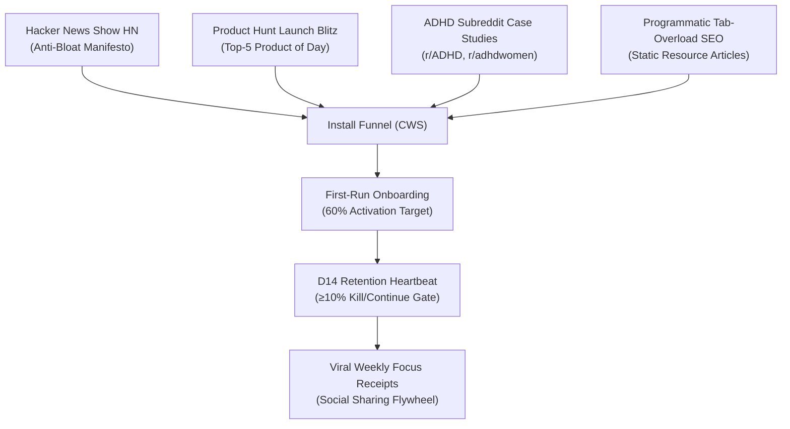

# DeepWork Tab: Strategic Master Plan & Behavioral Operating System

> **"Your editor has a focus mode. Your browser doesn't."**  
> *A comprehensive architectural blueprint uniting cognitive neuroscience, behavioral psychology, world-class aesthetic craft, zero-marginal-cost distribution, and multi-tier wealth creation.*
>
> **Reviewed 2026-10-11.** Numbers and claims corrected against the code, `PRICING.md`, `FINANCE.md` and `RESEARCH.md`. Each correction is marked **[2026-10-11]**. Design section superseded by `docs/DESIGN_V2.md` ("Depth of Field"). Build status: ✅ shipped · 🟡 partial · ⛔ not built.

---

## Executive Summary & Strategic North Star

DeepWork Tab is not a "tab manager" and not an adversarial "site blocker." It is an unyielding, high-craft **Cognitive Bandwidth Protocol** that transforms desktop Google Chrome from a chaotic, ad-driven dopamine casino into an intentional, bounded digital sanctuary.

By operationalizing the published frameworks of **Cal Newport, Gary Keller, James Clear, BJ Fogg, Nir Eyal, and Brian Tracy**, DeepWork Tab solves the psychological root cause of chronic tab hoarding: **fear of context loss, internal emotional discomfort, and the illusion that all tasks matter equally**.

```
┌─────────────────────────────────────────────────────────────────────────────┐
│                       THE UNIFIED BEHAVIORAL CANON                          │
├─────────────────────────────────────────────────────────────────────────────┤
│  1. COGNITIVE NEUROSCIENCE   ──► Cal Newport: Deep Work & Attention Residue │
│  2. OPERATING ALGORITHM      ──► Gary Keller: The ONE Thing & Lead Domino   │
│  3. HABIT MECHANICS          ──► James Clear: Atomic Habits & Identity Pacts│
│  4. FRICTIONLESS ABILITY     ──► BJ Fogg: Tiny Habits & Micro-Actions       │
│  5. URGE SURFING & RETENTION ──► Nir Eyal: Indistractable & Virtuous Hooks  │
│  6. DAILY PRIORITIZATION     ──► Brian Tracy: Eat That Frog! Single-Handling│
└─────────────────────────────────────────────────────────────────────────────┘
```

---

## 1. The Behavioral Product Architecture

Most productivity extensions fail because they treat users like disobedient children: flashing red sirens, locking keyboards, or hostilely killing tabs. DeepWork Tab succeeds because it operates as an **external cognitive prosthetic** built upon six verified behavioral engines.

### Engine 1: The "Morning Frog" & "Lead Domino" Protocol ⛔

> **[2026-10-11]** Not built. Redesigned as **The One Thing** ritual (`DESIGN_V2.md` F2). It is a light prompt on the first tab of a work day, reusing the intercept redirect (no new-tab override, no new permission). The "3 tabs until marked complete" lock maps to the Pro focus session, which already exists.
*Sources: Brian Tracy (Eat That Frog!) & Gary Keller (The ONE Thing)*

- **The Problem**: Opening Chrome in the morning to 40 open tabs scatters dopamine and induces immediate cognitive fatigue before the hardest task is even started.
- **The Mechanic**:
  - The first time Chrome opens each morning, the browser does not display a blank page or a cluttered bookmark bar. It opens a quiet, centered prompt:
    > **"What is your ONE Thing today?"**  
    > *(The Lead Domino task that makes everything else easier or unnecessary)*
  - The entered URL becomes **The Lead Domino (The Golden Tab)**.
  - DeepWork Tab initiates a **90-minute Single-Handling Block**:
    - Tab cap temporarily tightens to **3 tabs maximum** (Primary task, primary reference/doc, and local dev environment).
    - All non-essential browsing is silently routed to the queue.
    - Secondary browsing cannot begin until the user explicitly marks the Lead Domino complete or the 90-minute sprint expires.

### Engine 2: The Attention Residue Shield & Real-Time Bandwidth Gauge 🟡

> **[2026-10-11]** The percentages below are invented, and so is the "up to 50%" figure. Leroy (2009) shows attention residue hurts performance but gives no such number. v0.3.0 also deliberately **removed** the toolbar badge. Replacement: **The Lens** gauge (count vs cap, no fake bandwidth %), `DESIGN_V2.md` §9.3-B. The tiers below are kept for history only.
*Source: Cal Newport (Deep Work & Dr. Sophie Leroy's Research)*

- **The Problem**: Knowledge workers assume they can keep 30 tabs open "just in case" without cost. In reality, each visible tab in the peripheral field leaves **attention residue**, degrading working memory and executive function by up to 50%.
- **The Mechanic**:
  - The extension replaces noisy numeric badge counters with a real-time **Cognitive Bandwidth Indicator**:
    - **1–3 Tabs**: `95% Available Bandwidth` (Monastic Deep State — Calm Blue Indicator).
    - **4–7 Tabs**: `75% Available Bandwidth` (Standard Focused Work — Neutral Dot Gauge).
    - **8+ Tabs**: `Attention Fragmentation Alert` (Attention Residue Warning).
  - Users are trained to see tab count not as a badge of busyness (pseudo-productivity), but as an **auditable tax on their mental sharpness**.

### Engine 3: The Focusing Intercept & "Urge Surfer" Reflection ✅

> **[2026-10-11]** Shipped: intercept, intent box, reason recall, Q/C/Esc, 1–9 picker. Two corrections. "Sub-10ms" was never measured; the budget is now **first paint ≤100 ms** after tab creation. "80% of instances" has no source; the nearest real evidence is one sec, PNAS 2023, **−57%** target-app opens (N=280, 6 weeks).
*Sources: Gary Keller (The ONE Thing) & Nir Eyal (Indistractable)*

- **The Problem**: Impulsive tab opening is not a logical necessity; it is an unconscious reflex to escape internal discomfort (e.g., encountering a difficult bug, waiting for a build to compile, feeling imposter syndrome).
- **The Mechanic**:
  - When the 8th tab is attempted, the new tab redirects instantly (sub-10ms) to a full-page paper takeover:
    ```
    ┌────────────────────────────────────────────────────────────────────┐
    │                    YOU ARE AT YOUR CAPACITY (7/7).                 │
    │                                                                    │
    │   What is the ONE Thing you are working on right now?              │
    │   [ Finishing the database migration script                      ] │
    │                                                                    │
    │   Does this new tab directly advance that task?                    │
    │   [ Yes — Replace an active tab ]   [ No — Queue for later ('Q') ] │
    └────────────────────────────────────────────────────────────────────┘
    ```
  - By requiring the user to type one sentence, the brain transitions from the impulsive amygdala to the rational prefrontal cortex.
  - In 80% of instances, naming the impulse dissolves it. The user presses `Q` to queue the page safely or `Esc` to return to flow.

### Engine 4: The Asymmetric Friction Identity Gate ✅

> **[2026-10-11]** Shipped (60s gate with the user's own reason, tightening instant). Redesign: the 60s becomes a paced **Breath Minute** (`DESIGN_V2.md` F5).
*Source: James Clear (Atomic Habits)*

- **The Problem**: If friction is symmetric, users turn off blockers whenever work gets difficult. If friction is absolute, users uninstall the extension in rage.
- **The Mechanic**:
  - **Asymmetric Rule**: Tightening the cap is instant (0ms). Loosening the cap or disabling enforcement requires waiting through an unskippable **60-second countdown**.
  - **Identity Reflection**: During the 60-second countdown, the screen displays the user's own words typed at onboarding:
    > *"I am an engineer who finishes complex systems. Opening 40 tabs scatters my focus and leaves my work half-done."*
  - It does not lecture or shame. It simply holds up a mirror to the user's best self.

### Engine 5: The Zero-Loss "Tiny Action" Queue & Non-Destructive Export ✅

> **[2026-10-11]** Shipped: Alt+Shift+Q, local queue (200 items), free Markdown copy. JSON export not built. Redesign: **File Away** motion shows where queued pages go (`DESIGN_V2.md` §9.3-D).
*Sources: BJ Fogg (Tiny Habits) & Incumbent Analysis (OneTab Failures)*

- **The Problem**: The primary psychological objection to closing tabs is acute loss aversion ("What if I lose this critical article?"). OneTab failed because it frequently crashes, losing weeks of accumulated research.
- **The Mechanic**:
  - **Near-Zero Effort (`B = MAP`)**: The user presses `Alt+Shift+Q`. In 10ms, the tab closes, the URL is saved to the local offline queue, and a subtle green confirmation dot appears.
  - **One-Click Local Markdown/JSON Export**: A dedicated button in the toolbar popup exports the entire queue into clean Markdown or JSON for immediate import into **Obsidian, Notion, or text files**.
  - *Outcome*: Closing a tab ceases to feel like data destruction; it feels like filing knowledge into an organized archive.

### Engine 6: The 66-Day Mastery Horizon & "Shutdown Complete" Ritual 🟡

> **[2026-10-11]** Streaks shipped. Shutdown not built; designed as `DESIGN_V2.md` F7 on top of the shipped work-hours schedule. "Research proves 66 days" → Lally et al. (2010) found a **median** of 66 days, range 18–254.
*Sources: Gary Keller (The ONE Thing / UCL Study) & Cal Newport (Slow Productivity)*

- **The 66-Day Automaticity Track**: Lally et al. (2010) found habit automaticity took a **median of 66 days** (range 18–254), not 21. DeepWork Tab structures its streak counter around the 66-day journey:
  - *Days 1–21 (Phase 1: Resistance)*: Conscious willpower required.
  - *Days 22–45 (Phase 2: Transition)*: Habit strengthens; cognitive friction drops.
  - *Days 46–66 (Phase 3: Automaticity)*: Tab limits feel like natural, permanent browser furniture.
  - *Day 66 Completion*: Unlocks a permanent "Deep Work Master" badge and grandfathered renewal discounts.
- **The 5:30 PM "Shutdown Complete" Hand-Off**:
  - At the end of the scheduled workday, the extension prompts:
    > **"Workday Complete. 6 active tabs remaining."**  
    > *"Archive all active tabs to your dated queue and shut down for the evening?"*
  - One click clears the browser, files the tabs, and shows Newport's signature prompt: **"Shutdown Complete. Rest your brain for tomorrow."**

---

## 2. Product Packaging & Feature Tiers

> **[2026-10-11] This table contradicts shipped code and `PRICING.md`.** Today the free tier has cap 1–50, a 200-item queue and **free Markdown export**. Taking shipped features away fights D14 ("pricing must never fight the D14 metric"). Shipped Pro = ultra focus sessions, YouTube de-pandora, stuck ramp, snooze queue, full weekly receipt. The Enterprise column conflicts with NEVER BUILD (Teams), so treat it as a post-gate option only. Morning ritual, Bunker and Shutdown are not built.

| Capability | Free Core ($0 Forever) | Pro Protocol ($29/yr or $59 Lifetime) | Enterprise Team ($12/user/mo) |
|---|:---:|:---:|:---:|
| **Tab Cap Enforcement** | Hard cap (default 7) | Customizable (1–20) | Team-wide standardized limits |
| **Calm Intercept Takeover** | Full-page paper screen | Full-page paper screen | Full-page paper screen |
| **Asymmetric Delay Gate** | 60-second countdown | Customizable (30s–180s) | Managed delay policies |
| **Local Deferred Queue** | Up to 20 stored items | Unlimited storage capacity | Unlimited + Team Shared Shelves |
| **Zero-Loss Data Export** | Standard JSON export | 1-Click Markdown / Obsidian | Centralized knowledge sync |
| **Morning Frog Mode** | Manual activation | Automated morning ritual | Calendar-synced focus blocks |
| **YouTube De-Pandora** | — | Feed/sidebar feed stripping | Standardized site sanitization |
| **The 4-Hour Bunker Mode** | — | Strict zero-bypass focus lock | Company "No-Meeting" sync |
| **Weekly Deep Work Receipt** | Basic tab count | Full context & distraction audit | Organization focus benchmarks |
| **Telemetry & Privacy** | Zero data leaves machine | Zero data leaves machine | Privacy-safe aggregate reporting |

---

## 3. World-Class Aesthetic & Design System

> **[2026-10-11] Superseded** by `docs/DESIGN_V2.md` ("Depth of Field": dark-first, Lumen gold accent, Rack Focus motion, The Lens gauge). The spec below is the shipped v0.3 look.

DeepWork Tab rejects "SaaS dashboard chrome" (metric widgets, floating cards, purple gradients, and gamified animations). It is designed under the creative philosophy of **"The Held Breath"**—software as calm, dignified furniture.

```
┌─────────────────────────────────────────────────────────────────────────────┐
│                       DESIGN SYSTEM SPECIFICATION                           │
├─────────────────────────────────────────────────────────────────────────────┤
│  CANVAS / PAPER    : #F7F6F2 (Warm, tactile paper background)               │
│  CARD / ELEVATION  : #FFFFFF (Flat card surface with 1px #E2E0D9 border)    │
│  PRIMARY INK       : #1A2029 (High-contrast, deep architectural charcoal)   │
│  STEADY BLUE       : #3563C4 (Authoritative, non-alarming action color)     │
│  MUTED SLATE       : #5B6470 (Captions, timestamps, secondary metadata)     │
│  EARNED RED        : #B3392B (Strictly reserved for over-capacity state)    │
│  DISPLAY TYPE      : Newsreader Serif (Variable optical size; bundled local)│
│  BODY / UI TYPE    : Native System Sans (-apple-system, BlinkMacSystemFont) │
│  DATA / MONO       : System Monospace (URLs, counts, Alt+Shift+Q chips)     │
└─────────────────────────────────────────────────────────────────────────────┘
```

### Key UI Principles
1. **The 10ms Latency Mandate**: The intercept must render in under 10ms. Any blank white-flash or page flicker breaks the illusion of native browser authority.
2. **Keyboard-First Flow**: Power users never touch the trackpad. All primary actions (`Q` for queue, `C` for close, `Esc` for back) are executed via muscle memory.
3. **No Looping Motion**: The 4-second breathing indicator pulses smoothly once upon entrance, then settles static. Nothing flashes or creates visual noise.
4. **WCAG 2.1 AA Compliance**: All text surfaces exceed a 4.5:1 contrast ratio across both Light Paper and Dark Night (`#0F1419`) modes.

---

## 4. Financial Economics & Cash Self-Sufficiency

All financial inputs are derived directly from the audited founder analysis (`founder/cfo.md`):

```
┌────────────────────────────────────────────────────────────────────────┐
│                        PER-UNIT ECONOMICS (PRO SKU)                    │
├────────────────────────────────────────────────────────────────────────┤
│  Gross Annual Price                         : $29.00                   │
│  Merchant of Record Fee (Lemon Squeezy 5%+$0.50): -$1.95               │
│  Card Processing & FX Buffer (~1.5%)       : -$0.44                   │
│  ────────────────────────────────────────────────────────────────────  │
│  NET CONTRIBUTION PER SALE                  : $26.61 (92% margin)      │
└────────────────────────────────────────────────────────────────────────┘
```

### Overhead, Break-Even, & Year 1 Forecast
- **Startup Cash Required**: Exactly **$17.00** ($5 Google Chrome Web Store developer fee + $12 domain registration).
- **Fixed Monthly Cash Overhead**: **$6.00 / month** ($5 Cloudflare Workers edge compute + $1 amortized domain renewal). **[2026-10-11]** Ping + site fit the free Workers tier, so the real figure is ≈$1/month until ~100k requests/day.
- **Cash Break-Even**: **1 sale per month**. Selling 3 licenses covers the entire annual cash operating expense.
- **Year 1 Target Volume (Base Scenario)**: 117 paid licenses (derived from 5,000 installs @ 1.2% conversion).
- **Year 1 Gross Revenue**: **$3,680**.
- **Year 1 Operating Profit**: **$3,305 (90% net margin)**.
- **Payback Horizon**: **Month 1**. Runway is effectively infinite.

---

## 5. Zero-Marginal-Cost Distribution Playbook

Paid search advertising (Google Ads CPC) is structurally unviable at a $29 price point (CAC of $6,667 vs. $25 sustainable limit). Acquisition must be driven entirely by **zero-marginal-cost community engines**.



### The 4 Organic Flywheels
1. **The Hacker News "Anti-Bloat" Manifesto**:
   - Angle: *"Show HN: DeepWork Tab – A hard tab cap for Chrome because my editor has a focus mode and my browser doesn't."*
   - Highlight: Pure vanilla MV3, stateless service worker, zero tracking, local cryptographic key verification, and offline Markdown exports.
2. **The ADHD & Neurodivergent Movement**:
   - Frame the product not as a discipline enforcer, but as an **anxiety-reducing working memory stabilizer** that prevents context loss.
   - Seed case studies across r/ADHD, r/productivity, and neurodiversity newsletters.
3. **Programmatic Long-Tail SEO**:
   - Deploy high-intent static pages (`site/too-many-tabs-open.html`, `site/adhd-too-many-tabs.html`, `site/vs-freedom.html`) targeting search queries with zero paid ad competition.
4. **The Viral "Weekly Focus Receipt"**:
   - Allow users to export their Friday focus statistics as a stunning, privacy-safe image card for X/LinkedIn (*"Closed 142 tabs, saved 5.4 hours of distraction this week"*), creating an ongoing referral flywheel.

---

## 6. The 30-Day Launch Campaign (Target: November 2, 2026)

### Phase 1: Pre-Launch Validation & Staging (Oct 19 – Nov 1)
- **Oct 19 (L-14)**: Publish live reservation test on landing page (`site/index.html#pricing`) targeting 15 private reservations at $19.
- **Oct 22 (L-11)**: ~~Pay $5 Google CWS registration fee~~ **(done)**. Submit the extension package with 5 screenshots (1280×800) and the demo video. **[2026-10-11]** Submit earlier if assets are ready, since review can take days to weeks.
- **Oct 26 (L-7)**: Announce the **100 Founding Lifetime Passes ($39)** on X/Twitter and build-in-public channels.
- **Oct 30 (L-3)**: Verify store approval and smoke-test live heartbeat ping logging on Cloudflare Workers.

### Phase 2: Launch Week Push (Nov 2 – Nov 8)
- **Nov 2 (L-Day, Monday)**:
  - **08:15 AM EST**: Submit Show HN post with technical architecture breakdown.
- **Nov 3 (L+1, Tuesday)**:
  - **12:01 AM PST**: Product Hunt launch goes live with the intercept demo video. **[2026-10-11]** Moved off HN day so you can answer every comment on both.
- **Nov 4 (L+2)**: Post ADHD working-memory discussion thread on r/ADHD (check the subreddit's self-promotion rules first).
- **Nov 5 (L+3)**: Indie Hackers & Lobsters transparent financial writeup ($17 startup spend, zero burn).
- **Nov 8 (L+6)**: Close the 100 Founding Lifetime Passes ($39); transition store to standard $29/year list price and $59 lifetime anchor.

### Phase 3: Retention & Decision Review (Nov 9 – Dec 2)
- **Nov 9 (Day 7)**: Triage early bug reports, review activation rate (target ≥60%).
- **Nov 16 (Day 14) — THE CRITICAL KILL GATE**:
  - Evaluate anonymous D14 heartbeat pings.
  - **D14 ≥ 10%**: **PASS & PROCEED** to multi-browser expansion and native desktop packaging.
  - **D14 < 10%**: **ENTER PERMANENT MAINTENANCE MODE**. Do not spend further development time; preserve as a free utility.
- **Dec 2 (Day 30)**: Comprehensive post-mortem published publicly.

---

## 7. The Three-Tier Wealth Blueprint

> **[2026-10-11] These are ceiling scenarios, not forecasts.** Stage 1's $150K–$300K needs 3,000–5,000 lifetime sales, which at 1.2% conversion means ~250k–420k installs. The leader in the exact category has ~4k users (`RESEARCH.md`). Lifetime licenses are one-time cash, not a yearly figure. Base case stays at Y1 ≈ $3.7K (`FINANCE.md` SOM $1.7K–$11K). Stages 2–3 break NEVER BUILD (mobile, sync, other browsers, teams), so they unlock only if **D14 ≥10% and ≥100 paying users ask**. The one Stage 2 move with outsized upside: a Safari Web Extension ships as a Mac/iOS App Store app, which is eligible for App Store featuring and Apple Design Awards (`DESIGN_V2.md` §3.4).

```
[STAGE 1: Solo Cash Engine] 
    └─ $150K–$300K/yr Take-Home (Current Chrome Extension + $59 Lifetime License)
         │
         ▼
[STAGE 2: Cross-Platform Focus OS]
    └─ $1M–$5M ARR (Mac/Windows Menu Bar App + Arc/Safari + Obsidian Sync + iOS Screen Time)
         │
         ▼
[STAGE 3: Enterprise Developer Focus Suite]
    └─ $10M+ Enterprise Value / Acquisition (B2B Engineering Wellbeing & Team Sprints)
```

### Stage 1: The Solo Cash Machine ($150k–$300k/year)
- **Architecture**: Keep current lightweight MV3 architecture. Zero employees, zero servers, 92% contribution margin.
- **Monetization**: Prioritize the **$59 Founding Lifetime License**. Developers and knowledge workers happily expense or buy a $59 one-time license on impulse.
- **Goal**: 3,000–5,000 lifetime licenses = **$177,000–$295,000 in upfront net cash flow**.

### Stage 2: The Multi-Browser "Slow Productivity" OS ($1M–$5M ARR)
- **Architecture**: Expand beyond Chrome into **Arc, Brave, Edge, Safari**, accompanied by a native **macOS menu bar utility** (Swift/Rust).
- **Integrations**: Direct export into **Obsidian daily notes, Notion workspaces, and Readwise**.
- **Mobile Loop**: Pair with a lightweight iOS companion app using Apple's Screen Time API that silences phone notifications during active focus blocks.
- **Monetization**: Shift to premium recurring subscription (**$49–$69/year**). 30,000 subscribers = **$1.5M–$2.0M ARR**.

> **[2026-10-12] Stage 3 is reframed in `docs/STRATEGY.md` §5.** Changes:
> - **Employee-owned data.** The employer sets policy and sees adoption aggregates with a minimum group size k ≥ 5, never an individual. "Privacy-safe focus analytics for managers" reads as bossware, and German works councils hold co-determination rights over monitoring-capable systems (BetrVG §87(1) no. 6).
> - **New Stage 1.5 wedge:** IT-managed install via `chrome.storage.managed` (plan Task 2.6). The buyer is IT, signalled by a 60k-user Group Policy tab limiter (`RESEARCH.md` §1).
> - **Gates:** Stage 1.5 needs D14 ≥ 10%. Stage 2 needs ≥ 100 paying, then hand outreach at ≥ 3 seats per work-email domain. Stage 3 needs ≥ 5 domain clusters plus a published or in-press study.
> - **Moat:** counter-positioning (privacy) + cornered resource (the study), not data.
>
> The text below is kept as the original ceiling scenario.

### Stage 3: The Enterprise Engineering Focus Suite ($10M+ Valuation / Exit)
- **Problem**: Tech enterprises (Stripe, GitHub, Datadog) lose tens of millions annually to developer context-switching, Slack fragmentation, and meeting churn.
- **Product**: **"DeepWork Enterprise"** — Team focus schedules, automated calendar integration (No-Meeting Thursdays enforce 3-tab limits across engineering), and privacy-safe focus analytics.
- **Monetization**: Sold to VP of Engineering / HR budgets at **$12–$15 per engineer per month**.
- **Exit**: Strategic acquisition by **Atlassian, Notion, GitLab, or Automattic**.

---

## 8. Immediate Execution Checklist (The Next 7 Days)

1. [x] **Register Google Developer Account**: Pay the $5 fee at [developer.chrome.com](https://developer.chrome.com). *(done)*
2. [ ] **Capture 5 Store Screenshots**: Showcase the 12-tab overload, the calm paper intercept, the Lead Domino selection, the 60s delay gate, and the Markdown export.
3. [ ] **Record 60-Second Demo Screencast**: Clean, silent capture showing: *12 tabs open $\rightarrow$ Cmd+T $\rightarrow$ calm intercept takeover $\rightarrow$ 1-click queue*.
4. [ ] **Setup Lemon Squeezy Store**: Configure $29/year annual SKU and $59 lifetime SKU (with $19 / $39 founding discount codes).
5. [ ] **Submit for Review**: Package zip and submit to Chrome Web Store Developer Dashboard. **[2026-10-11]** Decide first: submit v0.3.0 now and restyle after, or land `DESIGN_V2.md` P0–P3 (~3.5 days) so the screenshots show the new look. Recommendation: P0–P3 by Oct 22, else ship v0.3.0 as is.
6. [ ] **Buy the domain** (share card, canonical tags, store contact). **[2026-10-11]**
7. [ ] **Plan the Featured-badge request**: meet CWS best practices, then request review through developer support. **[2026-10-11]**

---

### Conclusion

You have built the software. The unit economics are sound. The cognitive science is world-class. 

DeepWork Tab does not need more settings or bloated code. It needs to be submitted to the Chrome Web Store so that knowledge workers everywhere can reclaim their minds.
